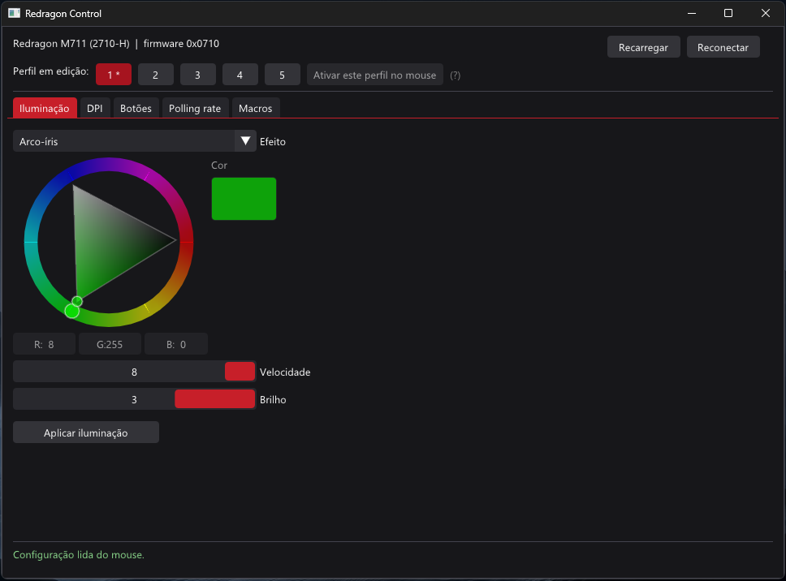

# Redragon Control

Software alternativo, leve e portátil para configurar o mouse **Redragon M711 (modelo interno 2710-H)** no Windows, substituindo o software oficial.

Um único `.exe`, sem instalador e sem dependências além do próprio Windows.

> Projeto pessoal e não oficial, sem qualquer vínculo com a Redragon. O protocolo foi obtido por engenharia reversa do software oficial. Use por sua conta e risco.



## Funcionalidades

- **Perfis:** edita os 5 perfis e escolhe qual fica ativo no mouse.
- **Iluminação:** efeito (respiração, arco-íris, estático, onda, reativo etc.), cor, velocidade e brilho.
- **DPI:** 5 estágios de 200 a 11400 DPI, cada um pode ser ativado ou desativado, e dá para escolher o estágio ativo.
- **Botões:** cada um dos 8 botões pode receber:
  - uma função (cliques, avançar/voltar, DPI+/−, desativado);
  - uma tecla ou combinação de teclas (ex.: Ctrl+C);
  - uma tecla de mídia;
  - uma macro;
  - um código personalizado em hexadecimal.
- **Polling rate:** 125, 250, 500 ou 1000 Hz.
- **Macros:**
  - 20 posições na memória do mouse, até 66 eventos cada;
  - gravação direto do teclado (com ou sem os tempos entre teclas) ou edição manual;
  - funcionam sem o programa aberto.

As configurações são gravadas na memória interna do mouse. Por isso o programa não precisa ficar em execução.

## Compatibilidade

| Item | Valor |
|---|---|
| Mouse | Redragon M711 / 2710-H (sensor P3327) |
| USB VID:PID | `04D9:FC30` (chip Holtek), revisão `0x0710` |
| Sistema | Windows 10/11 x64 |

O programa só procura este VID:PID. Outros mouses Redragon podem usar o mesmo protocolo, mas com mapas de memória diferentes, e **não são suportados**.

## Uso

1. Feche o software oficial da Redragon, porque os dois podem disputar o dispositivo.
2. Execute `RedragonControl.exe`.
3. Altere o que quiser e clique no botão "Aplicar" da aba.

Ferramenta de diagnóstico, que só faz leitura:

```
redragon-cli state
redragon-cli raw <endereço-hex> <tamanho>
redragon-cli macro <índice>
```

## Compilação

Requisito: Visual Studio 2022 ou mais recente, com a carga de trabalho **Desenvolvimento para desktop com C++**.

O Dear ImGui é um submódulo git, então clone com `--recursive`:

```
git clone --recursive https://github.com/SEU-USUARIO/redragon-m711-control.git
cd redragon-m711-control
build.bat
```

Se você já clonou sem `--recursive`, rode `git submodule update --init` antes de compilar.

O script localiza o Visual Studio sozinho e gera em `build\`:

- `RedragonControl.exe`, a interface gráfica;
- `redragon-cli.exe`, a ferramenta de diagnóstico.

A compilação usa C++20 e runtime estático (`/MT`), então os executáveis não dependem do Visual C++ Redistributable.

## Estrutura

```
src/
  hid_device.*       acesso HID via SetupAPI/hid.dll (sem hidapi)
  mouse_protocol.*   protocolo do mouse: memória, LED, DPI, botões, macros
  keys.*             tabelas de teclas HID / virtual-key / mídia
  app_ui.*           interface (Dear ImGui)
  app_main.cpp       janela Win32 + Direct3D 11
  cli_main.cpp       ferramenta de linha de comando
third_party/imgui/   Dear ImGui 1.91.9 (MIT), submódulo git
```

## Protocolo

A comunicação usa **HID feature reports** na interface de configuração (MI_02, Usage Page `0xFFA0`).

### Relatórios

| ID | Tamanho | Uso |
|---|---|---|
| `0x02` | 16 bytes | comandos curtos, escritas de até 8 bytes |
| `0x03` | 64 bytes | leitura e escrita de até 56 bytes |
| `0x04` | 1024 bytes | escrita de macros |

Cabeçalho: `[ID, cmd, addrLo, addrHi, len, 0, 0, 0]`, com os dados começando no byte 8.

| Comando | Significado |
|---|---|
| `F3` | escrever na memória |
| `F2` | ler da memória (SetFeature com o pedido, depois GetFeature) |
| `F1` | aplicar: `[02, F1, 02, flag]` |

Flags de aplicação: `01` perfil, `02` DPI, `04` LED, `08` polling, `10` estágio de DPI ativo.

### Mapa de memória

| Endereço | Conteúdo |
|---|---|
| `0x2C` | perfil ativo `[p, 0]` |
| `0x32 + 2p` | polling rate: `1`=1000, `2`=500, `4`=250, `8`=125 Hz |
| `0x446` | prefixo do LED `[0, 0]` |
| `0x449 + 8p` | LED: `[R, G, B, efeito, 9−velocidade, variante, brilho 1–3]` |
| `0x40`, `0x100`, `0x1B0`, `0x260`, `0x310` | base dos perfis 1–5 |
| `base + 2` | estágio de DPI ativo |
| `base + 4 + 6i` | estágio de DPI `[habilitado, códigoX, flagX, códigoY, flagY]` |
| `base + 0x42 + 4b` | botão `[código, a1, a2, a3]` |
| `0x478 + 200i` | macro `i` (gravada pelo relatório 4) |

DPI: `dpi = (índice + 1) × 100`, com índice de 1 a 113. O código enviado vem de uma tabela do sensor. A flag é `0` abaixo do índice 62, `1` abaixo de 93 e `4` a partir daí.

### Códigos de botão

| Código | Ação |
|---|---|
| `81` / `82` / `83` | clique esquerdo / direito / meio |
| `84` / `85` | voltar / avançar |
| `8A` / `89` | DPI+ / DPI− |
| `00` | desativado |
| `8F mods hid` | tecla ou combinação |
| `8E 01 lo hi` | tecla de mídia |
| `91 idx\|modo n` | macro (`n` repetições, `0x80` enquanto segurar, `0x40` alternar) |

### Eventos de macro

Cada evento tem 3 bytes:

| Código | Evento |
|---|---|
| `84` / `04` | tecla pressionada / solta (código HID) |
| `81` / `01` | botão do mouse pressionado / solto (máscara) |
| `06` | espera, em unidades de 10 ms |

## Estado

- **Leitura:** verificada no mouse real.
- **Gravação:** implementada reproduzindo as sequências do software oficial, ainda em validação.
- **Ainda deduzido, não testado:**
  - os códigos de botão marcados com `*` na interface;
  - a semântica exata dos modos de repetição de macro;
  - o intervalo de velocidade dos efeitos.

## Créditos

- [Dear ImGui](https://github.com/ocornut/imgui), de Omar Cornut (licença MIT).
